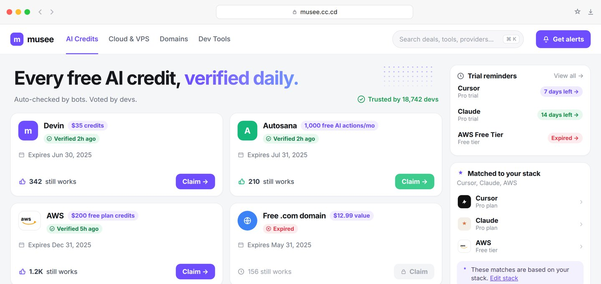

# musee

**Every free AI credit, verified daily.**

[musee.cc.cd](https://musee.cc.cd) is an early-stage open-source hub for free perks: AI credits, API quotas, cloud and VPS free tiers, and free domains. Bots re-check each offer. Developers vote on what still works.



*Home mockup. Vote totals and “Trusted by 18,742 devs” are sample figures, not live telemetry.*

Free tiers expire, trial cards flip to paid, and “$200 in credits” pages go stale without anyone noticing. musee is one place to see which perks are still live, when they end, and which ones match the tools you already use.

This repository is the source. The site is not deployed yet, and nothing here talks to a database. The home page (landing in a follow-up on `main`) renders seed data from the repo.

## Features

- **Bot-verified deals.** A scheduled check loads each offer URL, records the HTTP status, and looks for the expected promo text. A deal is marked live or expired from that result.
- **Community “still works” votes.** Anyone can confirm a perk still redeems. The count sits on the card next to Claim.
- **Trial reminders before auto-billing.** Track Cursor, Claude, AWS, and the rest, and get a nudge while the trial still has days left.
- **Stack matching.** Say you use Cursor, Claude, and AWS. The sidebar surfaces free tiers and upgrades that fit that stack.
- **Weekly digest.** One email, or later an SMS, with newly verified credits, expiring trials, and deals the community still trusts.

## Architecture

| Piece | Role |
| --- | --- |
| Next.js (App Router) on Vercel | Public site. Reads seed data today, Supabase when an account is connected. |
| Supabase (Postgres) | `deals`, `verification_runs`, `votes`, and `reminders`. |
| GitHub Actions cron | Daily job runs the checker and writes a verification report. |
| Email and SMS | Trial reminders and the weekly digest. Not wired yet. |

```
browser  →  Next.js on Vercel  →  Supabase
                     ↑
GitHub Actions cron  →  verify script  →  deals + verification_runs
```

The checker is a small Node script (`scripts/verify-deals.mjs`). It fetches each claim URL, stores the status code, and searches the body for a promo phrase such as “1,000 free AI actions”. A 2xx response that still contains the phrase is **live**. A missing phrase or an HTTP 4xx/5xx is **expired**. Timeouts and bot-walls (401, 403, 429) are recorded as **errors** so a block does not expire a real perk. Output is `verification/latest.json` (gitignored). The script does not update the site yet.

Playwright can replace the fetcher later, for perks that only appear after client-side render.

## Roadmap

- [x] Product mockup and this README
- [ ] Next.js home page with sample deals
- [ ] Supabase schema for deals, verification runs, votes, and reminders
- [ ] Daily verification workflow
- [ ] Connect the site to Supabase, with row level security
- [ ] Persist “still works” votes
- [ ] Email alert sign-up and the weekly digest
- [ ] Trial reminders before auto-billing
- [ ] Stack editor backed by an account
- [ ] SMS reminders
- [ ] Public “verified today” changelog

## Run locally

Node.js 20 or newer.

```bash
git clone https://github.com/wanghao2099-art/musee.git
cd musee
npm install
npm run dev
```

Open [http://localhost:3000](http://localhost:3000).

```bash
npm run build    # production build
npm run verify   # fetch each deal URL and write verification/latest.json
```

Apply `supabase/schema.sql` in the Supabase SQL editor when you are ready to store deals. The app does not need those credentials to boot.

## Layout

```
app/                         Next.js App Router UI
data/deals.json              sample catalog (the site reads this)
supabase/schema.sql          deals, verification_runs, votes, reminders
scripts/verify-deals.mjs     HTTP + promo-text checker
.github/workflows/           daily cron
docs/mockup.jpg              home mockup embedded above
```

The layout above is the shape of the project. Files land on `main` in small commits after this one.

## License

[MIT](LICENSE).
